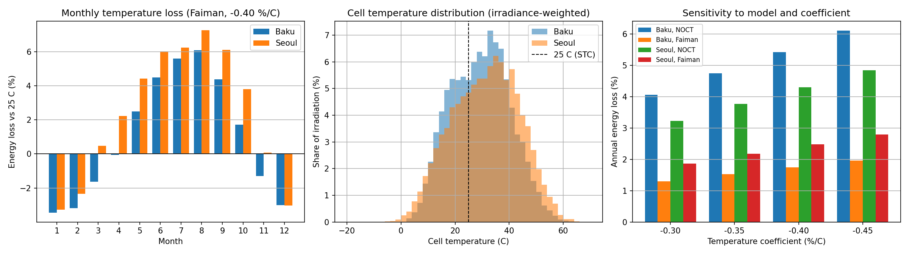

# PV temperature loss: Baku vs Seoul

Modelled temperature-related energy loss of silicon PV modules in Baku and Seoul, using hourly PVGIS-ERA5 data for 2015-2020.

## Method

- Hourly irradiance on a south-facing tilted plane, air temperature and 10 m wind speed from PVGIS API v5.2 (PVGIS-ERA5 database).
- Cell temperature from two models: NOCT (no wind term) and Faiman (with wind).
- Irradiance-weighted annual energy loss relative to 25 °C operation.
- Sensitivity analyses: temperature coefficient (-0.30 to -0.45 %/°C) and irradiance scaling (1.0 to 0.7).

## Main results (temperature coefficient -0.40 %/°C)

| | Baku | Seoul |
|---|---|---|
| Annual loss, NOCT model (%) | 5.42 | 4.30 |
| Annual loss, Faiman model (%) | 1.74 | 2.48 |
| Mean daytime wind speed at 10 m (m/s) | 6.15 | 2.47 |

Which city loses more depends on the thermal model: with wind included Seoul is higher, without wind Baku is higher. All results are modelled and are not validated against measured data.





## Run

```
pip install -r requirements.txt
python analysis.py
```

The script downloads the data from PVGIS and writes the outputs to `results/`.

## Data and citation

Input data: PVGIS, European Commission Joint Research Centre.

Preprint: Afandiyev, S. Temperature-Related Energy Loss of Silicon PV Modules in Baku and Seoul. Zenodo. https://doi.org/10.5281/zenodo.23465972

See `CITATION.cff` for how to cite this repository.
